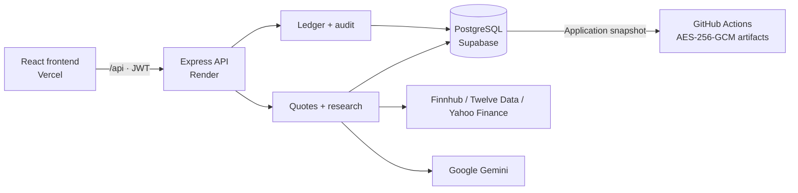

# Investment Tracker — Backend

> An Express API for an owner-specific investment ledger, MYR/USD cash tracking and stock research.

[Live app](https://investment-advisor-frontend-one.vercel.app/) · [Frontend & screenshots](https://github.com/Jxjx426/investment-advisor-frontend) · [Deployment & recovery](DEPLOYMENT.md)

## Key Features

- **Ledger:** independent Mine/Dad portfolios, fee-aware weighted cost, realized/unrealized P/L and eight-decimal fixed-point calculations.
- **Cash & corporate actions:** deposits, withdrawals, dividends, taxes, FX, owner transfers, splits and opening balances.
- **Reliable edits:** audit history, soft deletion, version checks and atomic bulk imports that reject invalid history or overselling.
- **Research:** cached quotes, daily price charts, headlines, keyword tone and on-demand Gemini summaries, with shared provider request budgets.
- **Private records:** account-scoped JWT access, verified database TLS, brokerage reconciliation and encrypted application backups.

## System Architecture



The API calculates holdings and cash by replaying each account's ledger. Transactions and per-user advisory locks keep edits and audit entries consistent. Supabase stores production data; SQLite powers the local demo.

## Technology Stack

| Technology | Purpose |
|---|---|
| Node.js 24 + Express 5 | API runtime and routing |
| PostgreSQL / Supabase | Persistent production data |
| better-sqlite3 | Local demo and isolated tests |
| bcrypt + JSON Web Tokens | Password hashing and signed sessions |
| Finnhub / Twelve Data | Market data, FX and headlines |
| Yahoo Finance | Delayed Bursa and USD/MYR fallback quotes |
| Google Gemini | Requested headline summaries |
| GitHub Actions | Tests and encrypted daily backups |

## Run Locally

Requires Node.js 24 and npm. For a disposable demo:

```bash
git clone https://github.com/Jxjx426/investment-advisor-backend.git
cd investment-advisor-backend
npm ci
npm run demo
```

The API runs at `http://127.0.0.1:3000`. Start the [frontend](https://github.com/Jxjx426/investment-advisor-frontend#run-locally) and sign in with `demo@local.test` / `local-preview-only`. Demo data resets on restart and never touches the cloud database. Live Research requires the configuration below.

### Persistent Database

Stop the demo, copy `.env.example` to `.env`, and configure:

| Variable | Purpose |
|---|---|
| `DATABASE_URL` | PostgreSQL connection; remote TLS verification is required |
| `JWT_SECRET` | A random secret of at least 32 bytes for production |
| `FINNHUB_API_KEY` | US quotes and news |
| `TWELVE_DATA_API_KEY` | Daily charts, FX and supported market quotes |
| `GEMINI_API_KEY` | Optional AI headline summaries |
| `ALLOWED_ORIGINS` | Allowed frontend origins |

For local SQLite instead, set `DB_CLIENT=sqlite` and `DB_FILE=tracker.local.db`. On an empty database, create the initial account, then start:

```bash
npm run create-user -- you@example.com
npm start
```

Startup applies versioned migrations atomically. For existing databases, reuse the account; public registration is disabled. `npm run reset-password -- you@example.com` provides an interactive reset. Keep `.env`, databases and backup keys out of Git.

## API Overview

| Endpoint | Purpose |
|---|---|
| `GET /ping` | Service and database health |
| `POST /auth/login` | Sign in and receive a token |
| `GET /tracker` | Owners, ledger, holdings, cash and quotes |
| `/tracker/transactions` | Create records; preview/bulk import, edit, void and audit subroutes |
| `GET /tracker/reconciliation` · `PUT /tracker/reconciliation` | Read or save brokerage comparisons |
| `GET /research/:market/:symbol/history` | Daily prices |
| `GET /research/:market/:symbol/news` | Headlines and keyword tone |
| `POST /research/:market/:symbol/summary` | Generate or retrieve a headline summary |
| `GET /backup` | Download only the signed-in account's records |

Tracker, research and records-download routes require `Authorization: Bearer <token>`. Monetary values are returned as decimal strings. See [routes/](routes) for request fields.

## Accounting & Data Notes

Owners have separate cost bases. Purchases include fees; sales allocate weighted cost and deduct sale fees. Replay order is date, same-day sequence, then ID. MYR/USD cash stays separate; capital flows are not trading profit.

Missing funding history and current-FX valuations remain estimates until reconciled. If Twelve Data cannot quote a Bursa stock or USD/MYR, the API tries Yahoo Finance's public delayed quotes, validating the symbol, exchange, currency and timestamp. This fallback needs no key and keeps its source/time; availability is not guaranteed. Older responses cannot replace newer cached prices. Missing prices stay unavailable, with a manual-price option. Bursa research/history still depends on the provider plan. AI summaries describe headlines and are not investment advice.

## Checks & Deployment

```bash
npm test
```

Tests cover accounting, authorization, audit, imports, research, TLS and recovery. CI includes PostgreSQL integration tests; locally, set `TEST_DATABASE_URL` to a disposable test database.

Render deploys `main` with `npm ci` and a `/ping` health check. The backup workflow schedules AES-256-GCM application snapshots at **08:15 Malaysia time**, retained for **30 days**; runs may be delayed. Configure its secrets when deploying your own copy. See [DEPLOYMENT.md](DEPLOYMENT.md) for production settings, migrations and recovery. Backups cover application tables, not the entire Supabase cluster.
